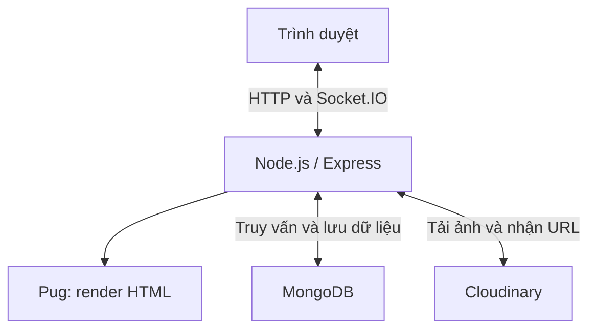
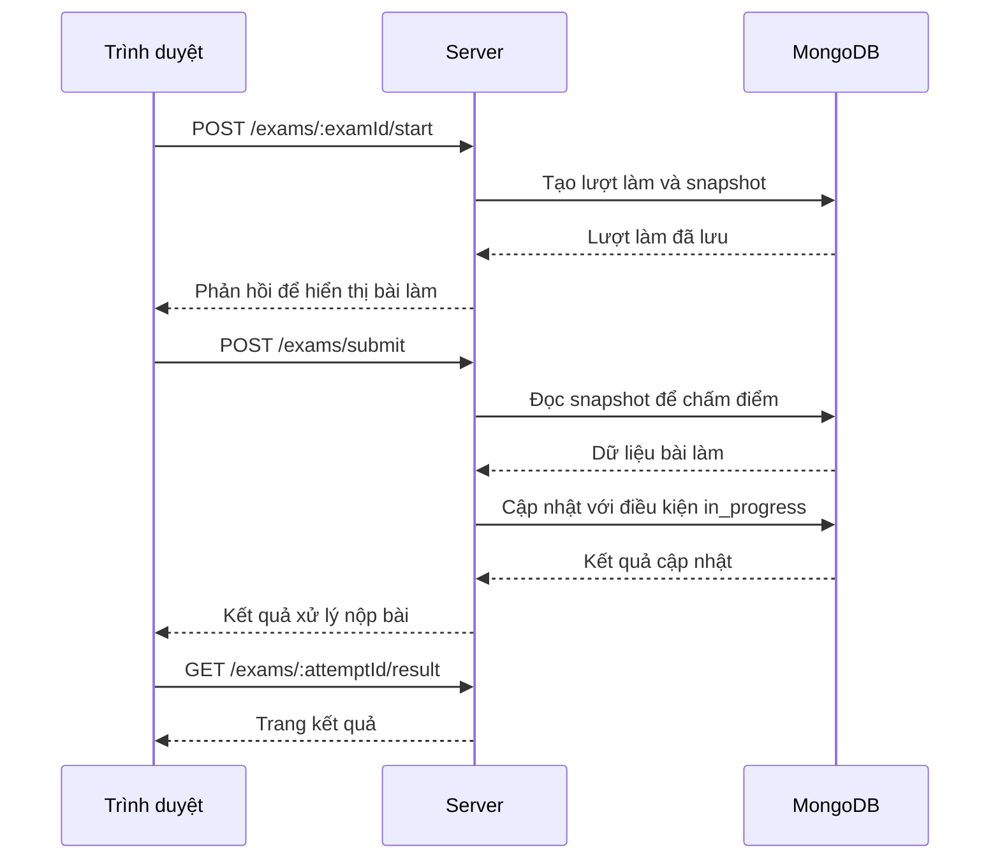

# Hệ thống ôn luyện thi tốt nghiệp THPT

Bài tập lớn môn Lập trình mạng — Năm học 2026–2027.

## 1. Thông tin dự án

### 1.1. Tên dự án

- Tên tiếng Việt: Hệ thống ôn luyện thi tốt nghiệp THPT.
- Tên mã nguồn: THPT Practice.

### 1.2. Đề tài

- Mã đề tài: [Điền mã đề tài đã đăng ký].
- Tên đề tài: [Điền tên đề tài đã được giảng viên duyệt].

### 1.3. Nhóm thực hiện

- Nhóm bài tập: [Điền số nhóm].
- Lớp học phần: [Điền mã lớp học phần Lập trình mạng].

| STT | Mã sinh viên | Họ và tên | Email | Nhiệm vụ chính | Đóng góp |
| --- | --- | --- | --- | --- | ---: |
| 1 | B23DCCN226 | Phùng Văn Dương | [Email] | [Nhiệm vụ thực tế] | [...]% |
| 2 | [MSSV] | [Họ tên] | [Email] | [Nhiệm vụ thực tế] | [...]% |
| 3 | [MSSV] | [Họ tên] | [Email] | [Nhiệm vụ thực tế] | [...]% |
| | | **Tổng** | | | **100%** |

### 1.4. Giảng viên hướng dẫn

[Điền họ tên giảng viên]. 
## 2. Tóm tắt dự án

### 2.1. Bài toán

Xây dựng website hỗ trợ học sinh ôn luyện thi tốt nghiệp THPT,
cho phép làm đề trực tuyến, luyện tập theo môn/chuyên đề,
xem kết quả và lời giải. Người dùng có thể tự soạn ngân hàng
câu hỏi, tạo đề cá nhân và chia sẻ đề trong nhóm học tập.

Hệ thống cần chấm điểm tự động, bảo toàn nội dung bài làm
khi câu hỏi gốc thay đổi và ngăn yêu cầu nộp lặp ghi đè
kết quả đã lưu.

### 2.2. Động lực thực hiện

Dự án hướng tới việc tập trung hoạt động soạn câu hỏi,
tạo đề, làm bài và học tập theo nhóm trên cùng một hệ thống,
giúp người dùng chủ động tổ chức nội dung ôn luyện.

Trong phạm vi môn Lập trình mạng, dự án vận dụng mô hình
client–server, giao tiếp HTTP, xác thực bằng JWT cookie
và thông báo realtime qua Socket.IO.

### 2.3. Mục tiêu

1. Xây dựng website có xác thực và phân quyền người dùng,
   quản trị viên.
2. Hỗ trợ làm bài và chấm điểm tự động với ba loại câu hỏi:
   trắc nghiệm, đúng/sai và điền đáp án.
3. Cho phép quản lý câu hỏi, tạo đề cá nhân và luyện tập
   theo môn/chuyên đề.
4. Hỗ trợ nhóm học tập, chia sẻ đề và thông báo realtime.
5. Bảo toàn dữ liệu bài làm bằng snapshot và kiểm soát
   cập nhật khi có nhiều yêu cầu nộp cùng một lượt.
6. Kiểm thử chức năng và đo hiệu năng trang danh sách
   đề thi tại các mức tải khác nhau.

### 2.4. Phạm vi

#### Trong phạm vi

- Website sử dụng qua trình duyệt.
- Đăng ký, đăng nhập và phân quyền user/admin.
- Quản lý môn học, chuyên đề, câu hỏi và đề thi.
- Soạn nội dung có công thức toán và hình ảnh.
- Làm bài, chấm điểm, xem kết quả và lịch sử bài làm.
- Luyện tập theo môn/chuyên đề.
- Quản lý câu hỏi và đề thi cá nhân.
- Tạo nhóm, duyệt thành viên và chia sẻ đề trong nhóm.
- Lưu và gửi thông báo realtime.

#### Ngoài phạm vi

- Tổ chức kỳ thi chính thức có giám sát và chống gian lận.
- Nhập hàng loạt câu hỏi từ Word/Excel.
- Tự động tạo đề theo ma trận kiến thức và mức độ khó.
- Ứng dụng di động riêng. 
## 3. Tổng quan hệ thống

### 3.1. Mô tả hệ thống

THPT Practice là website ôn luyện thi tốt nghiệp THPT,
sử dụng Node.js, Express, Pug và MongoDB.

Người dùng truy cập bằng trình duyệt để làm đề, luyện tập,
soạn câu hỏi và tổ chức học tập theo nhóm. Server xử lý
xác thực, phân quyền, chấm điểm và lưu trữ dữ liệu.
Giao diện được server render bằng Pug; thông báo realtime
được gửi qua Socket.IO. Hình ảnh tải lên được lưu
trên Cloudinary.

### 3.2. Đối tượng sử dụng

- **Người dùng:** học sinh có nhu cầu ôn luyện và người có
  nhu cầu soạn câu hỏi, tạo đề hoặc tổ chức nhóm học tập.
  Sử dụng tài khoản có vai trò `user`.
- **Quản trị viên:** quản lý tài khoản và nội dung chung
  của hệ thống. Sử dụng tài khoản có vai trò `admin`.

### 3.3. Các chức năng chính

| Chức năng | Mô tả | Trạng thái |
| --- | --- | --- |
| Xác thực và phân quyền | Đăng ký, đăng nhập, đăng xuất; kiểm soát quyền user/admin bằng JWT cookie | Đã triển khai |
| Làm đề trực tuyến | Bắt đầu lượt làm, đếm ngược thời gian và nộp bài | Đã triển khai |
| Chấm điểm và xem kết quả | Chấm câu trắc nghiệm, đúng/sai, điền đáp án; hiển thị điểm và lời giải | Đã triển khai |
| Lịch sử bài làm | Xem lại các lượt làm và kết quả đã lưu | Đã triển khai |
| Luyện tập | Luyện tập ngẫu nhiên theo môn/chuyên đề | Đã triển khai |
| Ngân hàng câu hỏi cá nhân | Soạn và quản lý câu hỏi có công thức toán, hình ảnh | Đã triển khai |
| Đề thi cá nhân | Tạo và quản lý đề thi cá nhân | Đã triển khai |
| Nhóm học tập | Tạo nhóm, xin tham gia, duyệt thành viên và chia sẻ đề | Đã triển khai |
| Thông báo | Nhận thông báo realtime và xem lại thông báo đã lưu | Đã triển khai |
| Quản trị hệ thống | Quản lý môn học, chuyên đề, câu hỏi, đề thi, công thức và người dùng | Đã triển khai | 
## 4. Kiến trúc hệ thống

### 4.1. Sơ đồ kiến trúc

Trình duyệt gửi yêu cầu HTTP đến Express và nhận trang HTML
hoặc dữ liệu JSON. Socket.IO dùng chung HTTP server để
gửi thông báo realtime đến người dùng.

### 4.2. Các thành phần

| Thành phần | Trách nhiệm |
| --- | --- |
| Client | Hiển thị giao diện, nhận thao tác người dùng, gửi yêu cầu HTTP và nhận thông báo Socket.IO |
| Server | Xác thực, phân quyền, xử lý nghiệp vụ, chấm điểm và điều phối truy cập dữ liệu |
| Pug | Tạo trang HTML từ dữ liệu do server cung cấp |
| MongoDB | Lưu tài khoản, nội dung ôn luyện, bài làm, nhóm và thông báo |
| Cloudinary | Lưu trữ hình ảnh được tải lên |

Mã nguồn server được tổ chức theo mô hình MVC:
routes định tuyến yêu cầu, middlewares kiểm tra truy cập,
controllers xử lý nghiệp vụ, models thao tác dữ liệu
và views hiển thị giao diện.

### 4.3. Luồng dữ liệu

#### Luồng làm bài

1. Người dùng chọn đề và gửi yêu cầu bắt đầu làm bài.
2. Server kiểm tra quyền truy cập, tạo lượt làm và lưu
   snapshot nội dung câu hỏi, đáp án, lời giải.
3. Trình duyệt hiển thị câu hỏi và đếm ngược thời gian.
4. Người dùng nộp bài hoặc trình duyệt tự gửi bài khi hết giờ.
5. Server chấm điểm dựa trên snapshot và cập nhật kết quả
   với điều kiện lượt làm vẫn ở trạng thái `in_progress`.
6. Người dùng được chuyển đến trang kết quả.

#### Luồng tải ảnh

1. Trình duyệt gửi ảnh đến server bằng `multipart/form-data`.
2. Server kiểm tra ảnh và tải lên Cloudinary.
3. Cloudinary trả URL ảnh cho server.
4. Server trả URL để trình soạn thảo chèn ảnh vào nội dung.

#### Luồng thông báo

1. Một thao tác nghiệp vụ phát sinh thông báo.
2. Server lưu thông báo vào MongoDB.
3. Server gửi sự kiện Socket.IO đến room của tài khoản nhận.
4. Nếu đang kết nối, trình duyệt cập nhật thông báo realtime.
   Người dùng có thể xem lại thông báo đã lưu khi truy cập. 
## 5. Thiết kế giao tiếp mạng

### 5.1. Mô hình giao tiếp

Hệ thống sử dụng mô hình client–server:

- Trình duyệt gửi yêu cầu HTTP đến Express để truy cập
  trang, gửi biểu mẫu và thực hiện các thao tác nghiệp vụ.
- Server trả về trang HTML, dữ liệu JSON hoặc phản hồi
  chuyển hướng tùy chức năng.
- Socket.IO duy trì kết nối để server chủ động gửi
  thông báo đến trình duyệt.

Frontend được phục vụ cùng server, không cần khởi chạy
một ứng dụng client riêng.

### 5.2. Giao thức sử dụng

| Giao tiếp | Công nghệ | Mục đích |
| --- | --- | --- |
| Trình duyệt – Server | HTTP | Truy cập trang, xác thực, quản lý nội dung và làm bài |
| Trình duyệt – Server | Socket.IO | Gửi và nhận sự kiện thông báo realtime |
| Server – MongoDB | MongoDB Driver thông qua Mongoose | Truy vấn và lưu dữ liệu |
| Server – Cloudinary | HTTPS thông qua SDK | Tải ảnh và nhận URL ảnh |

Socket.IO hỗ trợ WebSocket và HTTP long-polling tùy cấu hình
và điều kiện kết nối; không phải giao thức WebSocket thuần.

### 5.3. Định dạng thông điệp

#### HTTP

- Các trang giao diện được trả về dưới dạng `text/html`.
- Các thao tác dùng JavaScript có thể trao đổi dữ liệu JSON.
- Biểu mẫu được gửi theo định dạng do từng form quy định.
- Ảnh được tải lên bằng `multipart/form-data`.
- JWT được trình duyệt gửi kèm trong cookie; server xác minh
  trước khi cho phép truy cập chức năng được bảo vệ.

Một số yêu cầu trong luồng làm bài:

| Phương thức | Đường dẫn | Mục đích |
| --- | --- | --- |
| GET | `/exams` | Xem danh sách đề |
| GET | `/exams/:id` | Xem thông tin đề |
| POST | `/exams/:examId/start` | Bắt đầu lượt làm |
| POST | `/exams/submit` | Nộp bài |
| GET | `/exams/:attemptId/result` | Xem kết quả |

#### Socket.IO

Thông báo được trao đổi dưới dạng sự kiện kèm dữ liệu.
Server xác thực kết nối bằng JWT cookie và đưa socket
vào room `account:<accountId>` để gửi thông báo đến
đúng tài khoản.

Tên sự kiện và các trường dữ liệu phải thống nhất giữa
phần phát sự kiện trên server và phần lắng nghe trên client.

### 5.4. Trình tự giao tiếp

### 5.5. Xử lý lỗi

| Trường hợp | Cách xử lý |
| --- | --- |
| Chưa đăng nhập hoặc token không hợp lệ | Middleware chặn truy cập chức năng được bảo vệ |
| Không đủ quyền | Từ chối thao tác quản trị hoặc truy cập tài nguyên không thuộc quyền người dùng |
| Dữ liệu đầu vào không hợp lệ | Kiểm tra và từ chối yêu cầu, trả thông báo phù hợp |
| Tài nguyên không tồn tại | Thông báo không tìm thấy |
| Nộp lại lượt đã hoàn tất | Không cập nhật ghi đè kết quả đã lưu |
| Ảnh sai định dạng hoặc vượt giới hạn | Từ chối tải lên |
| Lỗi MongoDB hoặc Cloudinary | Xử lý lỗi và thông báo thao tác thất bại |
| Mất kết nối realtime | Thông báo đã lưu vẫn có thể được truy xuất lại khi người dùng truy cập hệ thống | 
## 6. Công nghệ sử dụng

| Nhóm | Công nghệ / Thư viện | Vai trò |
| --- | --- | --- |
| Ngôn ngữ | JavaScript | Lập trình server và xử lý tương tác trên trình duyệt |
| Môi trường thực thi | Node.js | Chạy ứng dụng phía server |
| Web framework | Express 5 | Định tuyến HTTP, middleware và xử lý yêu cầu |
| Giao diện | Pug, HTML, CSS | Render và trình bày giao diện |
| Giao tiếp realtime | Socket.IO | Gửi thông báo đến người dùng đang kết nối |
| Cơ sở dữ liệu | MongoDB | Lưu trữ dữ liệu hệ thống |
| ODM | Mongoose | Định nghĩa schema và thao tác với MongoDB |
| Xác thực | jsonwebtoken, cookie-parser | Tạo, đọc và xác minh JWT qua cookie |
| Hash mật khẩu | bcryptjs | Hash và kiểm tra mật khẩu |
| Soạn thảo | Quill, KaTeX | Soạn nội dung và công thức toán |
| Tải ảnh | Multer, Cloudinary | Tiếp nhận và lưu trữ hình ảnh |
| Cấu hình | dotenv | Đọc biến môi trường từ file `.env` |
| Nén và ghi log | compression, morgan | Nén phản hồi HTTP và ghi log truy cập |
| Quản lý gói | npm hoặc Yarn | Cài đặt thư viện và chạy script |
| Phát triển | nodemon | Tự khởi động lại server khi mã nguồn thay đổi |
| Kiểm thử tải | k6 | Đo thời gian phản hồi, thông lượng và tỷ lệ lỗi |
| Hệ điều hành thực nghiệm | Windows 11 | Chạy server, MongoDB và công cụ đo tải |

Danh sách thư viện và ràng buộc phiên bản được khai báo
trong `package.json`. File `yarn.lock` khóa phiên bản
dependency khi cài đặt bằng Yarn.