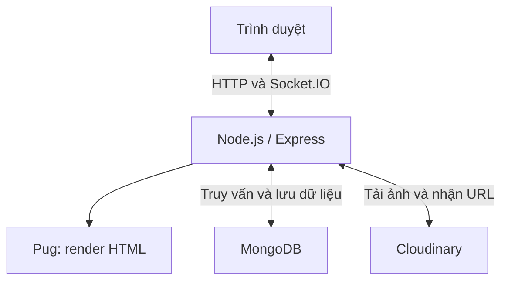
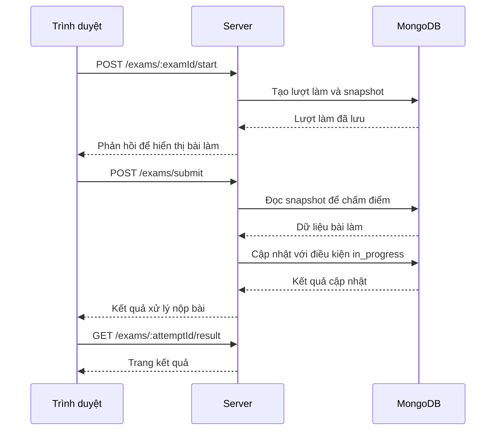

# Hệ thống ôn luyện thi tốt nghiệp THPT

Bài tập lớn môn Lập trình mạng — Năm học 2026–2027.

## 1. Thông tin dự án

### 1.1. Tên dự án

- Tên tiếng Việt: Hệ thống ôn luyện thi tốt nghiệp THPT.
- Tên mã nguồn: THPT Practice.

### 1.2. Đề tài

- Mã đề tài: [Điền mã đề tài đã đăng ký].
- Tên đề tài: [Điền tên đề tài đã được giảng viên duyệt].

### 1.3. Nhóm thực hiện

- Nhóm bài tập: [Điền số nhóm].
- Lớp học phần: [Điền mã lớp học phần Lập trình mạng].

| STT | Mã sinh viên | Họ và tên | Email | Nhiệm vụ chính | Đóng góp |
| --- | --- | --- | --- | --- | ---: |
| 1 | B23DCCN226 | Phùng Văn Dương | [Email] | [Nhiệm vụ thực tế] | [...]% |
| 2 | [MSSV] | [Họ tên] | [Email] | [Nhiệm vụ thực tế] | [...]% |
| 3 | [MSSV] | [Họ tên] | [Email] | [Nhiệm vụ thực tế] | [...]% |
| | | **Tổng** | | | **100%** |

### 1.4. Giảng viên hướng dẫn

[Điền họ tên giảng viên]. 
## 2. Tóm tắt dự án

### 2.1. Bài toán

Xây dựng website hỗ trợ học sinh ôn luyện thi tốt nghiệp THPT,
cho phép làm đề trực tuyến, luyện tập theo môn/chuyên đề,
xem kết quả và lời giải. Người dùng có thể tự soạn ngân hàng
câu hỏi, tạo đề cá nhân và chia sẻ đề trong nhóm học tập.

Hệ thống cần chấm điểm tự động, bảo toàn nội dung bài làm
khi câu hỏi gốc thay đổi và ngăn yêu cầu nộp lặp ghi đè
kết quả đã lưu.

### 2.2. Động lực thực hiện

Dự án hướng tới việc tập trung hoạt động soạn câu hỏi,
tạo đề, làm bài và học tập theo nhóm trên cùng một hệ thống,
giúp người dùng chủ động tổ chức nội dung ôn luyện.

Trong phạm vi môn Lập trình mạng, dự án vận dụng mô hình
client–server, giao tiếp HTTP, xác thực bằng JWT cookie
và thông báo realtime qua Socket.IO.

### 2.3. Mục tiêu

1. Xây dựng website có xác thực và phân quyền người dùng,
   quản trị viên.
2. Hỗ trợ làm bài và chấm điểm tự động với ba loại câu hỏi:
   trắc nghiệm, đúng/sai và điền đáp án.
3. Cho phép quản lý câu hỏi, tạo đề cá nhân và luyện tập
   theo môn/chuyên đề.
4. Hỗ trợ nhóm học tập, chia sẻ đề và thông báo realtime.
5. Bảo toàn dữ liệu bài làm bằng snapshot và kiểm soát
   cập nhật khi có nhiều yêu cầu nộp cùng một lượt.
6. Kiểm thử chức năng và đo hiệu năng trang danh sách
   đề thi tại các mức tải khác nhau.

### 2.4. Phạm vi

#### Trong phạm vi

- Website sử dụng qua trình duyệt.
- Đăng ký, đăng nhập và phân quyền user/admin.
- Quản lý môn học, chuyên đề, câu hỏi và đề thi.
- Soạn nội dung có công thức toán và hình ảnh.
- Làm bài, chấm điểm, xem kết quả và lịch sử bài làm.
- Luyện tập theo môn/chuyên đề.
- Quản lý câu hỏi và đề thi cá nhân.
- Tạo nhóm, duyệt thành viên và chia sẻ đề trong nhóm.
- Lưu và gửi thông báo realtime.

#### Ngoài phạm vi

- Tổ chức kỳ thi chính thức có giám sát và chống gian lận.
- Nhập hàng loạt câu hỏi từ Word/Excel.
- Tự động tạo đề theo ma trận kiến thức và mức độ khó.
- Ứng dụng di động riêng. 
## 3. Tổng quan hệ thống

### 3.1. Mô tả hệ thống

THPT Practice là website ôn luyện thi tốt nghiệp THPT,
sử dụng Node.js, Express, Pug và MongoDB.

Người dùng truy cập bằng trình duyệt để làm đề, luyện tập,
soạn câu hỏi và tổ chức học tập theo nhóm. Server xử lý
xác thực, phân quyền, chấm điểm và lưu trữ dữ liệu.
Giao diện được server render bằng Pug; thông báo realtime
được gửi qua Socket.IO. Hình ảnh tải lên được lưu
trên Cloudinary.

### 3.2. Đối tượng sử dụng

- **Người dùng:** học sinh có nhu cầu ôn luyện và người có
  nhu cầu soạn câu hỏi, tạo đề hoặc tổ chức nhóm học tập.
  Sử dụng tài khoản có vai trò `user`.
- **Quản trị viên:** quản lý tài khoản và nội dung chung
  của hệ thống. Sử dụng tài khoản có vai trò `admin`.

### 3.3. Các chức năng chính

| Chức năng | Mô tả | Trạng thái |
| --- | --- | --- |
| Xác thực và phân quyền | Đăng ký, đăng nhập, đăng xuất; kiểm soát quyền user/admin bằng JWT cookie | Đã triển khai |
| Làm đề trực tuyến | Bắt đầu lượt làm, đếm ngược thời gian và nộp bài | Đã triển khai |
| Chấm điểm và xem kết quả | Chấm câu trắc nghiệm, đúng/sai, điền đáp án; hiển thị điểm và lời giải | Đã triển khai |
| Lịch sử bài làm | Xem lại các lượt làm và kết quả đã lưu | Đã triển khai |
| Luyện tập | Luyện tập ngẫu nhiên theo môn/chuyên đề | Đã triển khai |
| Ngân hàng câu hỏi cá nhân | Soạn và quản lý câu hỏi có công thức toán, hình ảnh | Đã triển khai |
| Đề thi cá nhân | Tạo và quản lý đề thi cá nhân | Đã triển khai |
| Nhóm học tập | Tạo nhóm, xin tham gia, duyệt thành viên và chia sẻ đề | Đã triển khai |
| Thông báo | Nhận thông báo realtime và xem lại thông báo đã lưu | Đã triển khai |
| Quản trị hệ thống | Quản lý môn học, chuyên đề, câu hỏi, đề thi, công thức và người dùng | Đã triển khai | 
## 4. Kiến trúc hệ thống

### 4.1. Sơ đồ kiến trúc



Trình duyệt gửi yêu cầu HTTP đến Express và nhận trang HTML
hoặc dữ liệu JSON. Socket.IO dùng chung HTTP server để
gửi thông báo realtime đến người dùng.

### 4.2. Các thành phần

| Thành phần | Trách nhiệm |
| --- | --- |
| Client | Hiển thị giao diện, nhận thao tác người dùng, gửi yêu cầu HTTP và nhận thông báo Socket.IO |
| Server | Xác thực, phân quyền, xử lý nghiệp vụ, chấm điểm và điều phối truy cập dữ liệu |
| Pug | Tạo trang HTML từ dữ liệu do server cung cấp |
| MongoDB | Lưu tài khoản, nội dung ôn luyện, bài làm, nhóm và thông báo |
| Cloudinary | Lưu trữ hình ảnh được tải lên |

Mã nguồn server được tổ chức theo mô hình MVC:
routes định tuyến yêu cầu, middlewares kiểm tra truy cập,
controllers xử lý nghiệp vụ, models thao tác dữ liệu
và views hiển thị giao diện.

### 4.3. Luồng dữ liệu

#### Luồng làm bài

1. Người dùng chọn đề và gửi yêu cầu bắt đầu làm bài.
2. Server kiểm tra quyền truy cập, tạo lượt làm và lưu
   snapshot nội dung câu hỏi, đáp án, lời giải.
3. Trình duyệt hiển thị câu hỏi và đếm ngược thời gian.
4. Người dùng nộp bài hoặc trình duyệt tự gửi bài khi hết giờ.
5. Server chấm điểm dựa trên snapshot và cập nhật kết quả
   với điều kiện lượt làm vẫn ở trạng thái `in_progress`.
6. Người dùng được chuyển đến trang kết quả.

#### Luồng tải ảnh

1. Trình duyệt gửi ảnh đến server bằng `multipart/form-data`.
2. Server kiểm tra ảnh và tải lên Cloudinary.
3. Cloudinary trả URL ảnh cho server.
4. Server trả URL để trình soạn thảo chèn ảnh vào nội dung.

#### Luồng thông báo

1. Một thao tác nghiệp vụ phát sinh thông báo.
2. Server lưu thông báo vào MongoDB.
3. Server gửi sự kiện Socket.IO đến room của tài khoản nhận.
4. Nếu đang kết nối, trình duyệt cập nhật thông báo realtime.
   Người dùng có thể xem lại thông báo đã lưu khi truy cập. 
## 5. Thiết kế giao tiếp mạng

### 5.1. Mô hình giao tiếp

Hệ thống sử dụng mô hình client–server:

- Trình duyệt gửi yêu cầu HTTP đến Express để truy cập
  trang, gửi biểu mẫu và thực hiện các thao tác nghiệp vụ.
- Server trả về trang HTML, dữ liệu JSON hoặc phản hồi
  chuyển hướng tùy chức năng.
- Socket.IO duy trì kết nối để server chủ động gửi
  thông báo đến trình duyệt.

Frontend được phục vụ cùng server, không cần khởi chạy
một ứng dụng client riêng.

### 5.2. Giao thức sử dụng

| Giao tiếp | Công nghệ | Mục đích |
| --- | --- | --- |
| Trình duyệt – Server | HTTP | Truy cập trang, xác thực, quản lý nội dung và làm bài |
| Trình duyệt – Server | Socket.IO | Gửi và nhận sự kiện thông báo realtime |
| Server – MongoDB | MongoDB Driver thông qua Mongoose | Truy vấn và lưu dữ liệu |
| Server – Cloudinary | HTTPS thông qua SDK | Tải ảnh và nhận URL ảnh |

Socket.IO hỗ trợ WebSocket và HTTP long-polling tùy cấu hình
và điều kiện kết nối; không phải giao thức WebSocket thuần.

### 5.3. Định dạng thông điệp

#### HTTP

- Các trang giao diện được trả về dưới dạng `text/html`.
- Các thao tác dùng JavaScript có thể trao đổi dữ liệu JSON.
- Biểu mẫu được gửi theo định dạng do từng form quy định.
- Ảnh được tải lên bằng `multipart/form-data`.
- JWT được trình duyệt gửi kèm trong cookie; server xác minh
  trước khi cho phép truy cập chức năng được bảo vệ.

Một số yêu cầu trong luồng làm bài:

| Phương thức | Đường dẫn | Mục đích |
| --- | --- | --- |
| GET | `/exams` | Xem danh sách đề |
| GET | `/exams/:id` | Xem thông tin đề |
| POST | `/exams/:examId/start` | Bắt đầu lượt làm |
| POST | `/exams/submit` | Nộp bài |
| GET | `/exams/:attemptId/result` | Xem kết quả |

#### Socket.IO

Thông báo được trao đổi dưới dạng sự kiện kèm dữ liệu.
Server xác thực kết nối bằng JWT cookie và đưa socket
vào room `account:<accountId>` để gửi thông báo đến
đúng tài khoản.

Tên sự kiện và các trường dữ liệu phải thống nhất giữa
phần phát sự kiện trên server và phần lắng nghe trên client.

### 5.4. Trình tự giao tiếp



### 5.5. Xử lý lỗi

| Trường hợp | Cách xử lý |
| --- | --- |
| Chưa đăng nhập hoặc token không hợp lệ | Middleware chặn truy cập chức năng được bảo vệ |
| Không đủ quyền | Từ chối thao tác quản trị hoặc truy cập tài nguyên không thuộc quyền người dùng |
| Dữ liệu đầu vào không hợp lệ | Kiểm tra và từ chối yêu cầu, trả thông báo phù hợp |
| Tài nguyên không tồn tại | Thông báo không tìm thấy |
| Nộp lại lượt đã hoàn tất | Không cập nhật ghi đè kết quả đã lưu |
| Ảnh sai định dạng hoặc vượt giới hạn | Từ chối tải lên |
| Lỗi MongoDB hoặc Cloudinary | Xử lý lỗi và thông báo thao tác thất bại |
| Mất kết nối realtime | Thông báo đã lưu vẫn có thể được truy xuất lại khi người dùng truy cập hệ thống | 
## 6. Công nghệ sử dụng

| Nhóm | Công nghệ / Thư viện | Vai trò |
| --- | --- | --- |
| Ngôn ngữ | JavaScript | Lập trình server và xử lý tương tác trên trình duyệt |
| Môi trường thực thi | Node.js | Chạy ứng dụng phía server |
| Web framework | Express 5 | Định tuyến HTTP, middleware và xử lý yêu cầu |
| Giao diện | Pug, HTML, CSS | Render và trình bày giao diện |
| Giao tiếp realtime | Socket.IO | Gửi thông báo đến người dùng đang kết nối |
| Cơ sở dữ liệu | MongoDB | Lưu trữ dữ liệu hệ thống |
| ODM | Mongoose | Định nghĩa schema và thao tác với MongoDB |
| Xác thực | jsonwebtoken, cookie-parser | Tạo, đọc và xác minh JWT qua cookie |
| Hash mật khẩu | bcryptjs | Hash và kiểm tra mật khẩu |
| Soạn thảo | Quill, KaTeX | Soạn nội dung và công thức toán |
| Tải ảnh | Multer, Cloudinary | Tiếp nhận và lưu trữ hình ảnh |
| Cấu hình | dotenv | Đọc biến môi trường từ file `.env` |
| Nén và ghi log | compression, morgan | Nén phản hồi HTTP và ghi log truy cập |
| Quản lý gói | npm hoặc Yarn | Cài đặt thư viện và chạy script |
| Phát triển | nodemon | Tự khởi động lại server khi mã nguồn thay đổi |
| Kiểm thử tải | k6 | Đo thời gian phản hồi, thông lượng và tỷ lệ lỗi |
| Hệ điều hành thực nghiệm | Windows 11 | Chạy server, MongoDB và công cụ đo tải |

Danh sách thư viện và ràng buộc phiên bản được khai báo
trong `package.json`. File `yarn.lock` khóa phiên bản
dependency khi cài đặt bằng Yarn. 

## 7. Đóng góp kỹ thuật

### 7.1. Phương án cơ sở (Baseline)

Để làm rõ các lựa chọn thiết kế, dự án sử dụng hai phương án
cơ sở để đối chiếu:

- Lượt làm chỉ lưu tham chiếu đến câu hỏi gốc và sử dụng
  nội dung hiện tại khi xem lại hoặc chấm điểm. Khi câu hỏi
  bị chỉnh sửa, nội dung lịch sử có thể không còn phản ánh
  đúng thời điểm bắt đầu làm bài.
- Thao tác nộp bài kiểm tra trạng thái trước, sau đó cập nhật
  kết quả bằng một thao tác riêng không kèm điều kiện trạng thái.
  Nhiều yêu cầu có thể cùng vượt qua bước kiểm tra và tiếp tục
  cập nhật cùng một lượt làm.

Đây là các phương án cơ sở dùng để so sánh thiết kế,
không phải kết luận về mọi hệ thống luyện thi khác.

### 7.2. Giải pháp của dự án

#### Bảo toàn dữ liệu bằng snapshot

Khi bắt đầu lượt làm, server lưu bản sao nội dung câu hỏi,
các lựa chọn, đáp án và lời giải vào lượt làm.

Server sử dụng snapshot để chấm điểm và hiển thị kết quả,
giúp lượt làm không phụ thuộc vào những chỉnh sửa sau đó
của câu hỏi gốc.

#### Kiểm soát cập nhật kết quả

Khi lưu kết quả nộp bài, server đặt điều kiện trạng thái
`in_progress` ngay trong thao tác cập nhật MongoDB.

Chỉ lượt làm chưa hoàn tất mới được chuyển sang `submitted`.
Yêu cầu đến sau không thể dùng thao tác này để ghi đè
kết quả đã nộp.

### 7.3. Các đóng góp

| STT | Đóng góp | Ý nghĩa | Bằng chứng |
| --- | --- | --- | --- |
| 1 | Snapshot dữ liệu bài làm | Giữ nội dung tại thời điểm bắt đầu, phục vụ chấm điểm và xem lại | Mã nguồn tạo lượt làm; kiểm thử sửa câu hỏi sau khi bắt đầu |
| 2 | Cập nhật kết quả có điều kiện trạng thái | Kiểm soát chuyển trạng thái và ngăn nộp lặp ghi đè kết quả | Mã nguồn xử lý nộp bài; kiểm thử gửi lại yêu cầu nộp |

Đây là các đóng góp triển khai trong phạm vi dự án,
vận dụng những kỹ thuật đã có để giải quyết yêu cầu
bảo toàn dữ liệu và kiểm soát cập nhật.

### 7.4. So sánh phương án cơ sở và giải pháp

| Tiêu chí | Phương án cơ sở | Giải pháp của dự án |
| --- | --- | --- |
| Dữ liệu câu hỏi của lượt làm | Phụ thuộc câu hỏi gốc | Lưu snapshot trong lượt làm |
| Khi câu hỏi gốc thay đổi | Có thể ảnh hưởng việc chấm hoặc xem lại | Lượt đã tạo giữ nội dung snapshot |
| Kiểm tra trạng thái nộp | Kiểm tra riêng trước khi cập nhật | Kiểm tra trong thao tác cập nhật |
| Yêu cầu nộp lặp | Có nguy cơ ghi đè nếu thiếu điều kiện bảo vệ | Không cập nhật khi trạng thái đã là submitted |
| Chi phí lưu trữ | Ít dữ liệu sao chép hơn | Tăng dung lượng do lưu snapshot |

So sánh trên tập trung vào thiết kế và hành vi chức năng.
Dự án chưa thực hiện benchmark đối chứng hiệu năng giữa
phương án cơ sở và giải pháp đề xuất. Kết quả k6 ở phần
thực nghiệm chỉ đánh giá endpoint GET /exams. 

## 8. Cấu trúc mã nguồn

| Đường dẫn | Nội dung |
| --- | --- |
| `index.js` | Khởi tạo server, kết nối MongoDB và thiết lập Socket.IO |
| `package.json` | Khai báo thư viện và các script chạy ứng dụng |
| `yarn.lock` | Khóa phiên bản dependency khi sử dụng Yarn |
| `config/` | Cấu hình kết nối và dịch vụ |
| `routes/` | Định nghĩa các đường dẫn của người dùng và quản trị viên |
| `controllers/` | Xử lý yêu cầu và nghiệp vụ |
| `models/` | Định nghĩa schema và model Mongoose |
| `middlewares/` | Xác thực, phân quyền và xử lý tải ảnh |
| `views/` | Các template Pug |
| `public/` | CSS, JavaScript phía trình duyệt và hình ảnh |
| `services/` | Xử lý lưu và gửi thông báo |
| `sockets/` | Thiết lập kết nối và xác thực Socket.IO |
| `scripts/seed-accounts.js` | Tạo tài khoản demo |
| `tests/load/` | Script k6 và log kết quả kiểm thử tải |
| `README.md` | Giới thiệu dự án, hướng dẫn cài đặt, chạy và kiểm thử |
| `report/report.pdf` | Báo cáo đầy đủ của dự án | 

File `.env` được người chạy tạo tại thư mục gốc theo hướng dẫn
cấu hình. Không đưa thông tin bí mật thực tế vào mã nguồn công khai. 

## 9. Yêu cầu môi trường

| Thành phần | Yêu cầu |
| --- | --- |
| Node.js | Phiên bản từ 20.19 |
| Cơ sở dữ liệu | MongoDB chạy local hoặc MongoDB Atlas |
| Trình duyệt | Trình duyệt hiện đại có hỗ trợ JavaScript và cookie |
| Quản lý gói | npm đi kèm Node.js hoặc Yarn nếu muốn sử dụng thay npm |
| Lưu trữ ảnh | Tài khoản Cloudinary và thông tin cấu hình API |
| Git | Cần nếu lấy mã nguồn bằng lệnh `git clone` |
| k6 | Cài riêng nếu muốn chạy kiểm thử tải |

MongoDB phải được khởi động và có thể truy cập qua
`MONGO_URI` trước khi chạy seed hoặc sử dụng ứng dụng.

Máy chạy server cần kết nối Internet để tải ảnh lên
Cloudinary. Nếu sử dụng MongoDB Atlas, server cũng cần
kết nối đến dịch vụ Atlas.

Frontend được phục vụ cùng server, không cần cài đặt
hoặc khởi chạy một ứng dụng client riêng. 

## 10. Cài đặt và cấu hình

### 10.1. Lấy mã nguồn

```bash
git clone https://github.com/phungvanduong2101-oss/thpt-practice.git
cd thpt-practice
```

Hoặc tải và giải nén mã nguồn, sau đó mở terminal tại thư mục
chứa `package.json`.

### 10.2. Cài đặt thư viện

Sử dụng npm:

```bash
npm install
```

Hoặc Yarn:

```bash
yarn install
```

Chọn một trình quản lý gói để sử dụng trong các bước tiếp theo.

### 10.3. Cấu hình môi trường

Tạo file `.env` tại thư mục gốc:

```dotenv
MONGO_URI=mongodb://127.0.0.1:27017/THPT
JWT_SECRET=replace_with_a_long_random_secret

CLOUDINARY_CLOUD_NAME=
CLOUDINARY_API_KEY=
CLOUDINARY_API_SECRET=
```

- `MONGO_URI`: địa chỉ kết nối MongoDB. Thay bằng chuỗi kết nối
  Atlas nếu không sử dụng MongoDB local.
- `JWT_SECRET`: thay giá trị mẫu bằng chuỗi bí mật ngẫu nhiên,
  đủ dài, dùng để ký và xác minh JWT.
- `CLOUDINARY_*`: điền thông tin từ tài khoản Cloudinary khi
  sử dụng chức năng tải ảnh.

Không công khai file `.env` chứa thông tin bí mật thực tế.

### 10.4. Cơ sở dữ liệu và tài khoản demo

Khởi động MongoDB local hoặc bảo đảm kết nối Atlas đã được
cấu hình đúng trước khi chạy seed.

Không cần tạo database và collection thủ công; MongoDB tạo
khi ứng dụng tạo collection hoặc ghi dữ liệu.

Chạy lệnh tạo tài khoản demo:

```bash
npm run seed
```

Nếu dùng Yarn:

```bash
yarn seed
```

| Vai trò | Email | Mật khẩu demo |
| --- | --- | --- |
| Admin | `admin@example.com` | `Admin@123456` |
| User | `user@example.com` | `User@123456` |

Mật khẩu được hash bằng bcrypt. Nếu email đã tồn tại,
script bỏ qua tài khoản đó, không thay đổi mật khẩu hoặc quyền.

Sau khi chạy seed, có thể đăng nhập bằng các tài khoản trên.
Các bước tạo nội dung và chạy thử được trình bày ở mục tiếp theo. 
 
## 11. Chạy ứng dụng

### 11.1. Khởi động server

Chạy tại thư mục gốc của dự án.

Chế độ phát triển, tự khởi động lại khi mã nguồn thay đổi:

```bash
npm run dev
```

Hoặc:

```bash
yarn dev
```

Chạy thông thường:

```bash
npm start
```

Hoặc:

```bash
yarn start
```

Chỉ chọn một lệnh phù hợp. Giữ terminal đang chạy trong
quá trình sử dụng; nhấn `Ctrl+C` để dừng server.

### 11.2. Truy cập client

Mở trình duyệt tại:

http://localhost:3000

Ứng dụng hiện sử dụng cổng cố định `3000`.
Express phục vụ giao diện Pug cùng server,
không cần chạy frontend riêng.

Sau khi seed tài khoản:

1. Đăng nhập tại `/auth/login` bằng tài khoản admin.
2. Truy cập `/admin/dashboard`.
3. Tạo môn học → chuyên đề → câu hỏi → đề thi.
4. Xuất bản câu hỏi và đề thi cần sử dụng.
5. Đăng nhập bằng tài khoản user để chọn đề và làm bài.

### 11.3. Chạy nhiều client

Không cần khởi động thêm server.

- Mở nhiều tab với cùng tài khoản để kiểm tra thông báo
  và đồng bộ trạng thái đã đọc.
- Để sử dụng các tài khoản khác nhau đồng thời, mở các
  trình duyệt hoặc hồ sơ trình duyệt khác nhau.
  Các tab thông thường trong cùng hồ sơ dùng chung cookie
  đăng nhập.

### 11.4. Chạy kiểm thử tải

Cài k6 riêng và giữ server đang chạy.
Mở terminal khác tại thư mục gốc, chạy lần lượt:

```bash
k6 run --vus 10 --duration 1m tests/load/exams.js
k6 run --vus 50 --duration 1m tests/load/exams.js
k6 run --vus 100 --duration 1m tests/load/exams.js
```

Script gửi yêu cầu `GET /exams`, kiểm tra HTTP 200 và
nội dung HTML. Mỗi VU chờ phản hồi rồi nghỉ 1 giây.

## 12. Các chức năng chính và kiểm thử

Các trường hợp dưới đây được kiểm thử thủ công.
“Đạt” phản ánh kết quả quan sát trong các trường hợp đã thử,
không có nghĩa hệ thống không còn lỗi.

| STT | Chức năng | Trường hợp kiểm thử | Kết quả |
| --- | --- | --- | --- |
| 1 | Xác thực | Đăng ký, đăng nhập, đăng xuất; truy cập chức năng bảo vệ sau khi đăng xuất | Đạt |
| 2 | Phân quyền | Tài khoản user truy cập trang quản trị | Đạt |
| 3 | Quản lý nội dung | Tạo môn học, chuyên đề, câu hỏi và đề thi; kiểm tra dữ liệu đã lưu | Đạt |
| 4 | Chấm điểm | Làm bài có câu trắc nghiệm, đúng/sai và điền đáp án; đối chiếu điểm dự kiến | Đạt |
| 5 | Snapshot | Sửa câu hỏi gốc sau khi bắt đầu; kiểm tra lượt làm giữ nội dung cũ | Đạt |
| 6 | Nộp bài lặp | Gửi lại yêu cầu nộp cho lượt đã hoàn tất; kiểm tra kết quả không bị ghi đè | Đạt |
| 7 | Quyền sở hữu bài làm | Truy cập hoặc nộp lượt làm của tài khoản khác | Đạt |
| 8 | Nhóm học tập | Xin tham gia, duyệt thành viên và chia sẻ đề trong nhóm | Đạt |
| 9 | Realtime nhiều client | Mở hai tab cùng tài khoản; kiểm tra nhận thông báo và đồng bộ trạng thái đã đọc | Đạt |
| 10 | Thông báo đã lưu | Truy cập lại sau khi offline; kiểm tra xem được thông báo phát sinh | Đạt |
| 11 | Kiểm tra ảnh tải lên | Tải ảnh sai định dạng hoặc vượt giới hạn dung lượng cấu hình | Đạt |
| 12 | Lỗi dịch vụ | Kiểm tra phản hồi khi thao tác với MongoDB hoặc Cloudinary thất bại | Đạt | 
## 13. Thiết lập thực nghiệm

### 13.1. Môi trường

| Thành phần | Cấu hình |
| --- | --- |
| Hệ điều hành | Windows 11 |
| CPU | Intel Core i7-11800H |
| RAM | 16 GB |
| Node.js | v24.12.0 |
| MongoDB | Chạy local |
| Công cụ đo tải | k6 v2.3.0 |
| Triển khai | Server, MongoDB và k6 chạy trên cùng một máy |
| Địa chỉ truy cập | http://localhost:3000 |

Các số liệu phản ánh môi trường thử nghiệm trên localhost,
chưa bao gồm độ trễ mạng khi triển khai từ xa.

### 13.2. Dữ liệu thử nghiệm

Dữ liệu tại thời điểm đo gồm:

- 4 môn học.
- 60 câu hỏi.
- 10 đề thi.

Script seed tài khoản không thay thế cho việc chuẩn bị
dữ liệu môn học, câu hỏi và đề thi.

### 13.3. Kịch bản kiểm thử tải

Mục đích: đánh giá thời gian phản hồi, thông lượng và
tỷ lệ lỗi của chức năng xem danh sách đề khi tăng tải.

| Kịch bản | Endpoint | Số VUs | Thời gian |
| --- | --- | ---: | --- |
| 1 | GET /exams | 10 | 60 giây |
| 2 | GET /exams | 50 | 60 giây |
| 3 | GET /exams | 100 | 60 giây |

Trong mỗi kịch bản:

- Mỗi VU gửi yêu cầu, chờ phản hồi rồi nghỉ 1 giây
  trước khi gửi yêu cầu tiếp theo.
- Kiểm tra mã HTTP 200 và nội dung HTML.
- Mỗi mức tải chạy một lần.
- Các mức tải được chạy lần lượt, không chạy đồng thời.

Script: `tests/load/exams.js`.
Lệnh chạy được trình bày tại mục 11.4.

### 13.4. Chỉ số đánh giá

| Chỉ số | Ý nghĩa |
| --- | --- |
| Thời gian phản hồi trung bình | Giá trị trung bình của `http_req_duration` |
| p50 | 50% yêu cầu có thời gian phản hồi không vượt giá trị này |
| p95 | 95% yêu cầu có thời gian phản hồi không vượt giá trị này |
| Throughput | Số yêu cầu mỗi giây do k6 báo cáo |
| Tổng request | Tổng số yêu cầu HTTP trong lần chạy |
| Tỷ lệ lỗi HTTP | Giá trị `http_req_failed` do k6 ghi nhận |
| Checks | Tỷ lệ đạt các kiểm tra HTTP 200 và nội dung HTML |

Số VUs là mức tải người dùng ảo được cấu hình,
không đồng nghĩa với số người dùng thực tế mà toàn bộ
hệ thống có thể phục vụ.

Thực nghiệm chỉ đánh giá endpoint GET /exams.
Chưa đo mức sử dụng CPU/RAM và chưa benchmark
các chức năng khác.